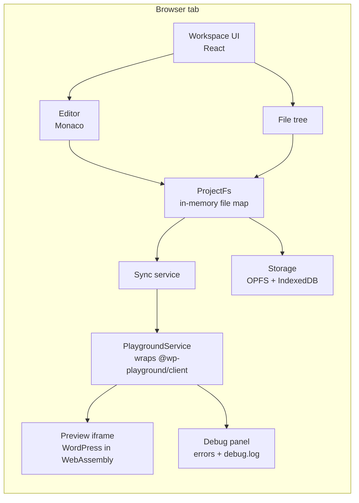

# Architecture

> Update this file when a module is added, removed or changes responsibility.

## 1. Overview

Everything runs in the developer's browser tab. There is no Pressbench server in the MVP; the only remote dependency
is the Playground remote page, `https://playground.wordpress.net/remote.html`, hosted by WordPress.org (see
[ADR 0001](adr/0001-browser-first-on-playground.md) for why it is not self-hosted in the MVP).



## 2. Folder layout

```text
pressbench/
├── AGENTS.md                # rules for AI agents (canonical)
├── CLAUDE.md                # Claude Code entry point, imports AGENTS.md
├── README.md
├── CHANGELOG.md
├── docs/                    # plan, standards, testing, ADRs, test cases
├── public/
├── scripts/                 # build-time scripts (generate-wp-data.ts, docs-check.ts)
├── src/
│   ├── app/                 # app shell, routes, providers, error boundary
│   ├── features/
│   │   ├── workspace/       # layout, panels, command palette
│   │   ├── file-tree/
│   │   ├── editor/          # Monaco setup, completion and hover providers
│   │   ├── preview/
│   │   ├── debug-panel/
│   │   ├── scaffolding/
│   │   ├── projects/        # list, import, export
│   │   └── sharing/
│   ├── lib/
│   │   ├── playground/      # the ONLY place that imports @wp-playground/*
│   │   ├── fs/              # ProjectFs: file map, path validation
│   │   ├── storage/         # the ONLY place that touches OPFS / IndexedDB
│   │   ├── sync/            # ProjectFs → Playground sync, debounce
│   │   ├── logger/
│   │   └── result.ts
│   ├── data/                # generated: wp-functions.json, wp-hooks.json (+ source versions)
│   └── ui/                  # shared components, tokens.css
├── templates/               # scaffold templates: plugin/, block-theme/, block/
└── tests/
    ├── e2e/                 # Playwright specs, fixtures/, pages/ (page objects)
    ├── integration/         # Vitest + @wp-playground/cli
    └── fixtures/            # sample zips, logs, projects
```

## 3. Key modules

| Module                 | Responsibility                                                                 | Public API (sketch)                                                                                                                                                                                                   |
| ---------------------- | ------------------------------------------------------------------------------ | --------------------------------------------------------------------------------------------------------------------------------------------------------------------------------------------------------------------- |
| `lib/playground`       | Boot, run PHP, read/write files, activate plugins, navigate, persist           | `PlaygroundService` interface; `createWebPlaygroundService(options)` (browser); `createPlaygroundService({ connect })` (core, also used over `@wp-playground/cli` in Node); `createFakePlaygroundService()` for tests |
| `lib/result`           | `Result<T, E>` with `ok()` / `err()` helpers                                   | Every service method that can fail returns a `Result`; nothing throws across a module boundary                                                                                                                        |
| `features/preview`     | Phase 1: spike panel (versions, start, status, iframe); later the preview pane | `<PlaygroundPanel service={…} />`, `usePlaygroundState(service)`                                                                                                                                                      |
| `lib/fs`               | In-memory project files, path validation, change events                        | `ProjectFs` with `read`, `write`, `rename`, `remove`, `list`, `onChange`                                                                                                                                              |
| `lib/sync`             | Push `ProjectFs` changes into Playground, debounce, status                     | `createSync(fs, playground)` → `status$`, `flush()`                                                                                                                                                                   |
| `lib/storage`          | Save/load projects in OPFS; metadata in IndexedDB; quota                       | `ProjectRepository` with `list`, `load`, `save`, `remove`, `estimateQuota`                                                                                                                                            |
| `features/editor`      | Monaco lifecycle, language mapping, WordPress completion and hover             | `<CodeEditor path=… />`, `registerWordPressProviders(monaco)`                                                                                                                                                         |
| `features/debug-panel` | Parse PHP errors and debug.log, show and link to lines                         | `parseDebugLog(text)`, `<DebugPanel />`                                                                                                                                                                               |
| `features/scaffolding` | Render templates, validate inputs                                              | `generateProject(kind, options)`                                                                                                                                                                                      |
| `features/projects`    | Project list, zip import/export                                                | `importZip(file)`, `exportZip(project)`                                                                                                                                                                               |
| `features/sharing`     | Encode/decode share links                                                      | `encodeShare(project)`, `decodeShare(hash)`                                                                                                                                                                           |

## 4. Data flow: edit → preview

1. Editor change marks the tab dirty in the workspace store.
2. Save writes to `ProjectFs`, which emits a change event.
3. `sync` debounces (150 ms), writes changed files to Playground, sets status to `synced`.
4. Preview listens for `synced` and reloads the iframe on its current URL.
5. `storage` saves the project to OPFS in the background.
6. Debug panel re-reads `debug.log` after each reload.

## 5. Decisions

Architecture decisions are recorded in [adr/](adr/). Current:

- [ADR 0001: Browser-first on WordPress Playground](adr/0001-browser-first-on-playground.md)
